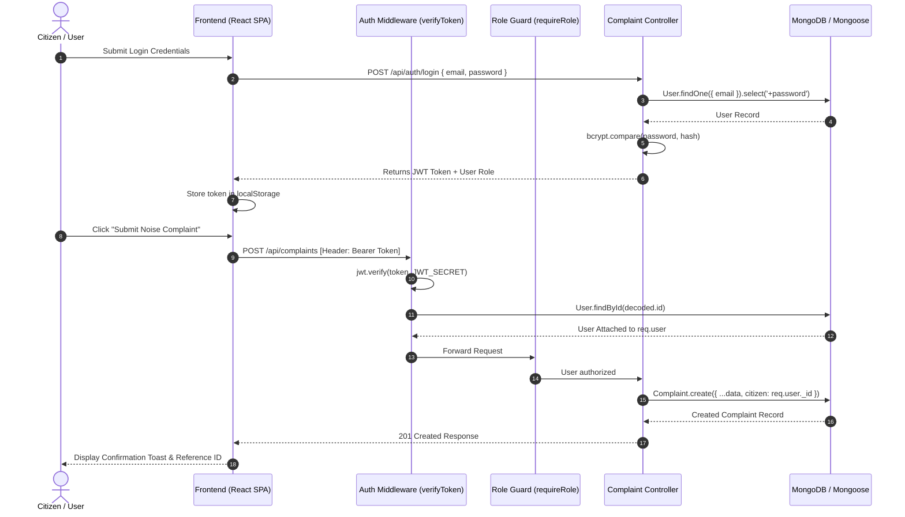
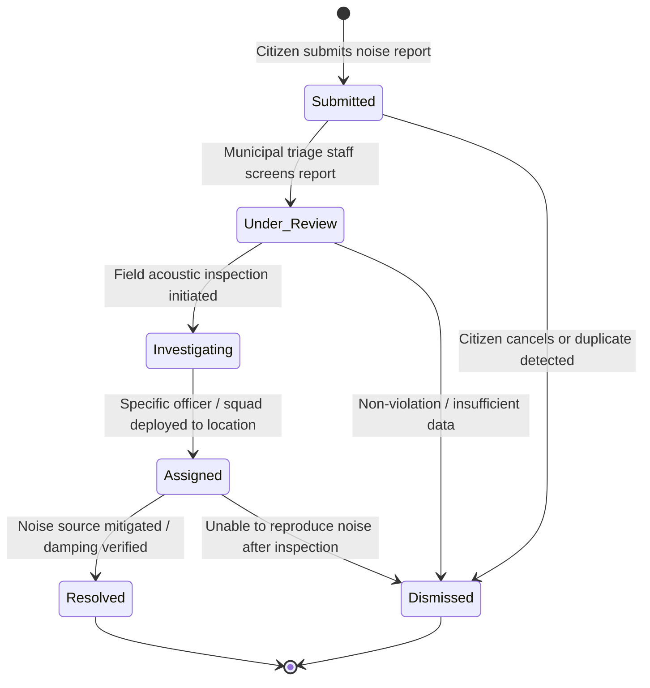

# Smart Urban Noise Monitoring System
## System Architecture & Technical Design

---

### 1. High-Level Architecture Overview

The system is constructed using a decoupled client-server architecture:
- **Presentation Layer (Frontend):** React 18 Single Page Application (SPA) bundled with Vite, styled with Tailwind CSS, utilizing React Router v6 for client-side routing, and Lucide React for consistent line iconography.
- **Application Layer (Backend):** Node.js runtime running Express.js, providing a REST API with JWT-based authentication, role-based authorization guards, input sanitization, and structured error propagation.
- **Persistence Layer (Database):** MongoDB object modeling with Mongoose schemas. Supports both local/remote MongoDB instances (e.g. MongoDB Atlas) and an automatic zero-config In-Memory MongoDB fallback (`mongodb-memory-server`) for evaluation.

```
┌────────────────────────────────────────────────────────┐
│                   CLIENT (BROWSER)                     │
│  React 18 SPA (Vite) + Tailwind CSS + Lucide Icons     │
│  - Citizen Portal (/overview, /report, /map, etc.)     │
│  - Municipal Staff Portal (/staff/*)                   │
└──────────────────────────┬─────────────────────────────┘
                           │ HTTP REST (JSON + JWT)
                           ▼
┌────────────────────────────────────────────────────────┐
│                   EXPRESS REST API                     │
│  - verifyToken & requireRole Middleware               │
│  - Controllers: Auth, Complaints, Hotspots, Stats      │
│  - Centralized Error Handler                           │
└──────────────────────────┬─────────────────────────────┘
                           │ Mongoose ODM
                           ▼
┌────────────────────────────────────────────────────────┐
│                   MONGODB DATABASE                     │
│  - Users Collection (Citizens, Municipal Staff)        │
│  - Complaints Collection (Status history, coordinates) │
│  - Hotspots Collection (Chennai schematic zones)       │
└────────────────────────────────────────────────────────┘
```

---

### 2. Request & Authentication Flow



---

### 3. Complaint State Machine Diagram



---

### 4. Security Architecture & Access Control

1. **Password Security:**
   - User passwords are encrypted using `bcryptjs` with 10 salt rounds prior to saving (`pre('save')` Mongoose hook).
   - Passwords are set with `select: false` on the User schema so they are never returned in general queries or API responses.
2. **Stateless JWT Authentication:**
   - Tokens are cryptographically signed using `jsonwebtoken` with HMAC-SHA256 and an environment-configurable secret and expiration (`7d`).
   - Every protected route passes through `verifyToken` middleware which decodes the payload, validates signature and expiration, and hydrates `req.user`.
3. **Role-Based Authorization (RBAC):**
   - The system strictly enforces role privileges on the backend:
     - `requireRole('citizen', 'staff')` for citizen-accessible routes.
     - `requireRole('staff')` strictly gating staff triage and status mutation endpoints (`/api/complaints/:id/status`, `/api/complaints`, `/api/stats/staff-dashboard`).
   - Public self-registration (`POST /api/auth/register`) strictly sets `role: 'citizen'`, preventing privilege escalation during sign-up.
4. **Data Isolation:**
   - Citizens querying `/api/complaints/my` receive only complaints matching their own MongoDB ObjectId (`{ citizen: req.user._id }`).
   - Direct access to single complaints (`/api/complaints/:id`) ensures that citizens can only read or delete their own records.
